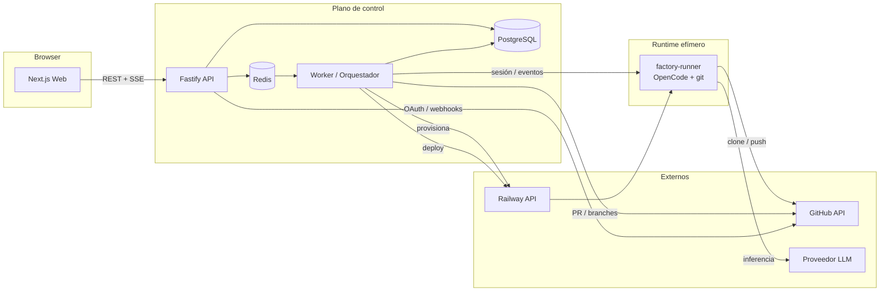
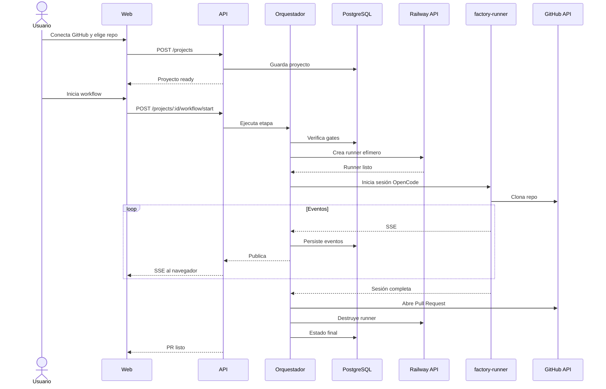

# Architecture

Guardar en: `.quinoto-spec/discovery/03-architecture.md`

**Discovery Date:** 2026-11-08

## Diagrama conceptual

## Capas y responsabilidades

| Capa | Paquete / app | Responsabilidad |
|---|---|---|
| Presentación | `apps/web` | UI, estados, SSE client. No accede a DB ni a tokens. |
| Transporte | `apps/api` | Auth de integraciones, validación, REST, SSE, webhooks, encolado. |
| Dominio | `packages/core` | Workflow, gates, artefactos, config, crypto, redacción. |
| Persistencia | `packages/db` | Schema Drizzle, repositorios Postgres y en memoria, migraciones. |
| Integraciones | `packages/adapters-github`, `packages/adapters-railway` | Contratos y clientes externos. |
| Runtime | `infra/runner` | OpenCode + git + toolchain en contenedor aislado. |
| Orquestación | `apps/worker` | Esqueleto; la lógica corre hoy en `apps/api/src/services`. |

## Patrones de diseño

- **Puertos y adaptadores:** el core no conoce GitHub ni Railway; los adaptadores implementan interfaces.
- **Repository pattern:** `GitHubInstallationRepository`, `ProjectRepository`, `WorkflowRepository`, `ArtifactRepository`, `ApprovalRepository`, `SessionStore`, `RailwayLinkRepository`, `AuditRepository`.
- **State machine:** etapas y transiciones explícitas con gates (`packages/core/src/workflow.ts`).
- **Dependency injection:** `ApiDependencies` se construye en `bootstrap.ts` y se inyecta en las rutas.
- **SSE:** logs de sesión en vivo con `Last-Event-ID`.
- **Redacción centralizada:** `redactValue` se aplica antes de persistir eventos y auditoría.

## Flujo principal (secuencia)

## Componentes reutilizables

- `packages/core`: config, crypto, redacción, workflow, artefactos, sesiones.
- `packages/db`: repositorios intercambiables (memoria/Postgres).
- `packages/adapters-github`: manifest, JWT, tokens, repos, PRs, webhooks.
- `packages/adapters-railway`: runners y deploys con mock incluido.
- `packages/ui`: utilidades compartidas.

## Decisiones arquitectónicas clave

1. Monorepo TypeScript con contratos compartidos.
2. Next.js para UI y Fastify para API/SSE.
3. PostgreSQL + Drizzle con migraciones versionadas.
4. GitHub App con manifest flow y tokens de instalación.
5. Runner efímero en Railway, un contenedor por sesión.
6. AES-256-GCM con `FACTORY_MASTER_KEY`.
7. SSE para logs; sin WebSocket en v1.
8. Adaptadores aislados para permitir GitLab/Vercel en v2.

## Integraciones

| Integración | Uso | Estado |
|---|---|---|
| GitHub API | repos, branches, PRs, webhooks | Implementado; requiere credenciales reales. |
| Railway API | runners y deploys | Implementado con cliente GraphQL; validar schema con token real. |
| OpenCode | sesiones de agente | Imagen runner creada; falta orquestación real de la sesión. |
| Proveedor LLM | inferencia del agente | Requiere `OPENCODE_MODEL_API_KEY`. |
