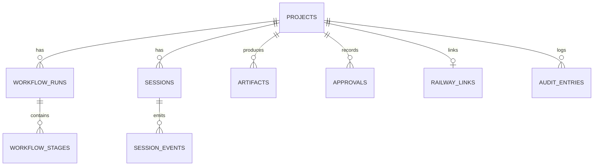

# Data & Services

Guardar en: `.quinoto-spec/discovery/05-data-and-services.md`

**Discovery Date:** 2026-11-08

## Base de datos

- **Motor:** PostgreSQL 16 (contenedor `postgres` en Compose).
- **ORM:** Drizzle ORM 0.38.
- **Migraciones:** `packages/db/drizzle/` (`0000` a `0004`), aplicadas por el servicio `migrate`.
- **Comando:** `pnpm --filter @factory/db db:migrate`.
- **Fallback:** si no hay `DATABASE_URL`, la API usa repositorios en memoria (útil para tests y desarrollo).

## Tablas principales

### `github_installations`

| Campo | Tipo | Notas |
|---|---|---|
| `id` | uuid PK | |
| `app_id` | text | ID de la GitHub App |
| `slug` | text | Slug de la app |
| `client_id` | text | |
| `installation_id` | integer | Se completa al instalar |
| `account_login` | text | Cuenta de GitHub |
| `private_key_ciphertext` | text | PEM cifrado con AES-256-GCM |
| `webhook_secret_ciphertext` | text | Secreto cifrado |
| `created_at`, `updated_at` | timestamptz | |

### `projects`

| Campo | Tipo | Notas |
|---|---|---|
| `id` | uuid PK | |
| `name` | text | |
| `repo_full_name` | text | `owner/repo` |
| `default_branch` | text | |
| `installation_id` | integer | |
| `status` | text | default `ready` |
| `created_at`, `updated_at` | timestamptz | |

### `workflow_runs` y `workflow_stages`

- `workflow_runs`: `id`, `project_id` (FK), `current_stage`, `status`, timestamps.
- `workflow_stages`: `id`, `run_id` (FK), `stage`, `status`, `attempts`, `started_at`, `finished_at`, `error`.

### `artifacts`

`id`, `project_id` (FK), `run_id` (FK opcional), `session_id` (opcional), `kind`, `path`, `checksum`, `created_at`.

### `approvals`

`id`, `project_id` (FK), `subject`, `decision` (`approved`/`rejected`), `decided_by`, `decided_at`, `scope`, `rationale`.

### `sessions` y `session_events`

- `sessions`: `id`, `project_id` (FK), `stage`, `prompt`, `status`, `runner_service_id`, `started_at`, `ended_at`, `max_minutes`.
- `session_events`: `id` bigserial, `session_id` (FK), `type`, `payload` jsonb, `created_at`.

### `railway_links`

`id`, `project_id` (FK único), `railway_project_id`, `service_id`, `environment_id`, `last_deployment_id`, `last_deploy_status`, `last_deploy_url`, timestamps.

### `audit_entries`

`id` bigserial, `project_id` (FK opcional), `actor`, `action`, `subject`, `detail` jsonb, `created_at`.

## Relaciones

## Servicios externos

| Servicio | Propósito | Configuración |
|---|---|---|
| GitHub API | Repos, branches, PRs, webhooks | GitHub App + installation tokens |
| Railway API | Runners efímeros y deploys | `RAILWAY_API_TOKEN` (mock si falta) |
| OpenCode | Ejecución del agente | Imagen `factory-runner` |
| Proveedor LLM | Inferencia del agente | `OPENCODE_MODEL_API_KEY` |

## Seeds y datos iniciales

- No hay seeds automáticos.
- La GitHub App se crea con el manifest flow y se guarda cifrada.
- Los proyectos se crean desde `POST /projects`.

## Retención y respaldo

- Los eventos de sesión y la auditoría se guardan en Postgres; no hay política de retención automática todavía.
- Backup: `pg_dump -U factory -d factory -Fc` (ver `docs/operations.md`).
- Restore: `pg_restore --clean --if-exists`.
- Los volúmenes `pgdata` y `redisdata` persisten entre reinicios de Compose.
