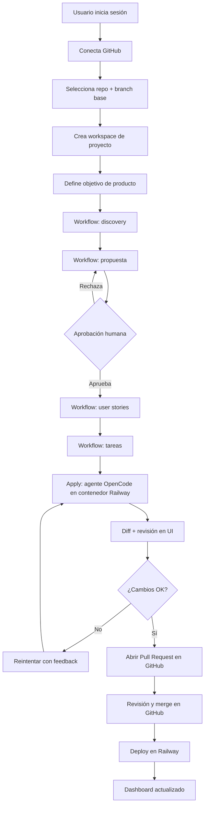
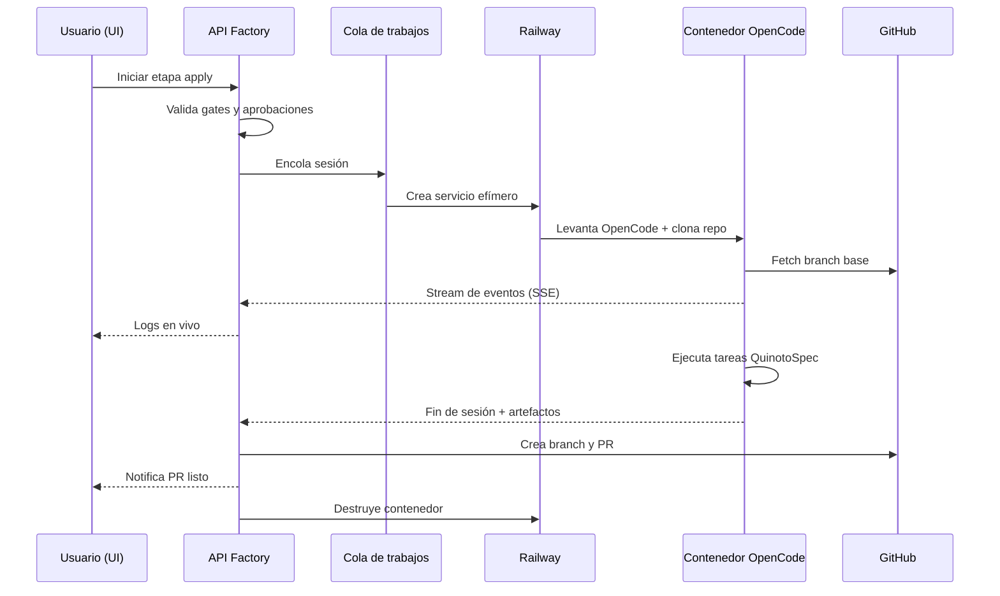

# Product Requirements Document: Quinoto Software Factory

## 1. Resumen Ejecutivo

**Problema/Oportunidad.** Hoy, usar OpenCode junto con QuinotoSpec es potente pero artesanal:
hay que abrir una terminal, clonar el repo, lanzar sesiones de agente, copiar y pegar prompts,
respetar el orden discovery → propuesta → user stories → tareas → apply, crear ramas, abrir PRs
y desplegar a mano. El resultado es un flujo difícil de adoptar por equipos, imposible de
observar en tiempo real y sin trazabilidad entre lo que decidió el agente y lo que terminó en el
repositorio. Cada persona lo ejecuta distinto y el conocimiento queda en logs de terminal.

**Propuesta de valor.** Una aplicación web **open source y self-hosted** que actúa como plano de
control de la fábrica de software: conecta un repositorio de GitHub, orquesta el workflow de
QuinotoSpec, ejecuta agentes de OpenCode en contenedores efímeros sobre Railway, muestra el
progreso en vivo y entrega cada cambio como un Pull Request revisable. El usuario conserva sus
credenciales, su infraestructura y su código; la app solo aporta orden, visibilidad y repetibilidad.

**Impacto esperado.**

- Reducir el tiempo desde "repo conectado" hasta "primer PR abierto" a **menos de 15 minutos**.
- Que **≥70%** de las sesiones de agente terminen en un PR revisable en la v1.
- Que **100%** de los cambios generados queden vinculados a un artefacto de QuinotoSpec y a un commit.
- Poner en marcha la instancia self-hosted en **menos de 30 minutos** con Docker Compose.

**Alcance de la v1.** GitHub (repos + PRs), Railway (runtime de agentes + deploy), orquestación
del workflow QuinotoSpec, sesiones OpenCode con logs en vivo y dashboard multi-proyecto. Todo lo
demás queda explícitamente fuera (ver §5.3).

## 2. User Personas

| Persona | Descripción | Necesidades | Pain Points |
|---------|-------------|-------------|-------------|
| **Sofía — Dev fullstack independiente (early adopter open source)** | 29 años, construye productos propios y prototipos. Usa OpenCode a diario y conoce QuinotoSpec de nombre. | Arrancar un proyecto desde una idea y llegar a un PR sin cambiar de contexto; ver qué está haciendo el agente; poder corregirlo sin reiniciar todo. | Pierde tiempo en ceremonia git; las sesiones de agente se desincronizan; no sabe en qué paso del workflow está; el contexto se pierde entre terminales. |
| **Marcos — Tech lead de un equipo chico (3–8 devs)** | 38 años, mantiene 4–6 repos. Quiere estandarizar cómo el equipo usa agentes sin perder control. | Gobernanza mínima: quién ejecutó qué, con qué artefactos, qué terminó en main. Revisar antes de mergear. | Cada dev usa el agente a su manera; no hay auditoría; los PRs llegan sin contexto; es imposible comparar proyectos. |
| **Ana — Platform / DevOps engineer (self-hoster)** | 34 años, opera la infraestructura del equipo. Le importa el costo, los secretos y la reproducibilidad. | Desplegar la factory con un compose, gestionar tokens de forma segura, limitar costos de Railway, ver logs y cancelar sesiones. | Miedo a filtrar tokens; costos de contenedores fuera de control; debugging de sandboxes; upgrades que rompen todo. |
| **Lucía — Product owner no técnica (stakeholder)** | 41 años, define prioridades y aprueba alcance. No usa terminal. | Ver el estado de cada proyecto, leer propuestas y aprobar o pedir cambios desde la UI. | No puede leer logs de CLI; depende de que un dev le traduzca el estado; se entera tarde de los desvíos. |

## 3. Problem Statement

**Declaración del problema.** Los equipos que quieren usar agentes de IA para construir software
de forma seria no tienen un lugar único donde conectar repositorio, workflow, ejecución del
agente, revisión y deploy. OpenCode resuelve la ejecución y QuinotoSpec resuelve el proceso, pero
la costura entre ambos queda a cargo de cada persona, a mano y sin registro.

**Contexto.** Ocurre en el día a día de un dev o un equipo chico: se elige un repo, se decide un
cambio, se lanza el agente, se revisan archivos, se commitea, se abre un PR, se despliega. Cada
paso vive en una herramienta distinta (terminal, GitHub, Railway, editor). El estado del workflow
QuinotoSpec vive en archivos `.quinoto-spec/` que nadie mira hasta el final. Cuando algo falla, el
diagnóstico depende de la memoria de quien ejecutó el agente.

**Impacto.**

- **Tiempo:** entre 30 y 90 minutos por ciclo manual (setup, prompts, ramas, PR, deploy) que la
  app busca reducir a menos de 15.
- **Calidad:** PRs sin contexto ni artefactos asociados; revisiones que discuten el "qué" en vez
  del "cómo"; retrabajo por pasos salteados.
- **Adopción:** QuinotoSpec se percibe como burocracia porque su valor no es visible; los equipos
  lo abandonan después de la primera semana.
- **Riesgo:** credenciales repartidas en terminales y variables de entorno; cambios directos a
  `main`; costos de infraestructura sin medición.

## 4. Goals & Objectives

| Objetivo | Métrica | Target | Timeline |
|----------|---------|--------|----------|
| **O1. Onboarding sin terminal** | Tiempo desde instancia levantada hasta primer PR abierto | ≤ 15 min (mediana) | v1 |
| **O2. Workflow confiable** | % de sesiones de agente que terminan en PR revisable | ≥ 70% | v1 |
| **O3. Trazabilidad total** | % de PRs con artefacto QuinotoSpec y sesión vinculados | 100% | v1 |
| **O4. Self-host simple** | Tiempo de instalación con Docker Compose en máquina limpia | ≤ 30 min | v1 |
| **O5. Costo bajo control** | Costo mediano por sesión de agente y tope configurable | Visible + cap por proyecto | v1 |
| **O6. Adopción inicial** | Instancias activas con ≥1 proyecto y ≥1 PR en 30 días | 50 instancias | 90 días post-launch |
| **O7. Retención de uso** | % de proyectos con actividad semanal | ≥ 40% | 90 días post-launch |

## 5. Feature Requirements

### 5.1 Core Features (P0 — imprescindibles para v1)

| Feature | Descripción | Prioridad | Estimación |
|---------|-------------|-----------|------------|
| **F1. Conexión GitHub** | Autenticación con GitHub (App u OAuth según decisión técnica), listado de repos y selección de repo + branch base. | P0 | L |
| **F2. Workspace de proyecto** | Un proyecto = un repo conectado. Creación, estado, configuración y borrado. | P0 | M |
| **F3. Orquestador QuinotoSpec** | Máquina de estados que ejecuta discovery → proposal → user stories → tasks → apply, respetando dependencias y gates. Muestra el artefacto producido en cada paso. | P0 | XL |
| **F4. Runtime de agentes en Railway** | Cada sesión corre en un contenedor efímero con OpenCode + repo clonado. Crear, iniciar, cancelar y reintentar sesión. | P0 | XL |
| **F5. Logs y eventos en vivo** | Stream de actividad del agente (mensajes, tool calls, archivos tocados) vía SSE/WebSocket, con historial persistido. | P0 | L |
| **F6. Diff y Pull Request** | Al terminar, la app muestra el diff, permite revisarlo y abre un PR con resumen, artefactos y links. Nunca push directo a `main`. | P0 | L |
| **F7. Adaptador Railway (deploy)** | Vincular proyecto a un proyecto/servicio de Railway, disparar deploy del repo y mostrar estado y URL. | P0 | L |
| **F8. Dashboard multi-proyecto** | Vista única con proyectos, etapa actual del workflow, sesiones activas, PRs abiertos y último deploy. | P0 | M |
| **F9. Gestión de secretos** | Tokens de GitHub/Railway y API keys de modelos cifrados en reposo; nunca en logs ni en el repo. | P0 | M |
| **F10. Auditoría / timeline** | Registro append-only de acciones: quién, qué agente, qué prompt, qué artefacto, qué commit, qué PR. | P0 | M |
| **F11. Instalación self-hosted** | Docker Compose con app, base de datos y cola; migraciones automáticas; healthcheck. | P0 | M |

### 5.2 Secondary Features (P1/P2 — deseadas, no bloqueantes)

| Feature | Descripción | Prioridad | Estimación |
|---------|-------------|-----------|------------|
| **F12. Aprobaciones desde UI** | Aprobar propuesta/stories/tareas con registro de decisión (human-in-the-loop). | P1 | M |
| **F13. Medidor de costo** | Consumo estimado por sesión/proyecto y tope configurable con corte automático. | P1 | M |
| **F14. Re-ejecución de etapas** | Reintentar una etapa desde un checkpoint sin perder artefactos previos. | P1 | M |
| **F15. Visor de artefactos** | Render Markdown de propuestas, stories, tareas y discovery dentro de la app. | P1 | S |
| **F16. Notificaciones** | Email/webhook al abrir PR, fallar una sesión o requerir aprobación. | P1 | S |
| **F17. Plantillas de proyecto** | Arrancar con un stack y convenciones predefinidas. | P1 | M |
| **F18. RBAC por equipo** | Roles admin/dev/viewer en una instancia self-hosted. | P2 | L |
| **F19. Integraciones adicionales** | GitLab, Bitbucket, Vercel, Linear, Jira, Slack. | P2 | XL |
| **F20. Federación multi-repo** | Orquestar varios repos/proyectos como una unidad (Bifrost). | P2 | XL |

### 5.3 Out of Scope (v1)

- SaaS multi-tenant, billing, planes y límites por cuenta.
- App móvil o desktop nativa.
- Editor de código o IDE embebido.
- Auto-merge sin revisión humana.
- Proveedores Git distintos de GitHub (GitLab/Bitbucket) y clouds distintos de Railway.
- Ejecución de agentes en la máquina del usuario (runner local).
- Firma de commits, SSO empresarial y compliance certificado (SOC2, etc.).
- Mercado de plantillas/agentes de terceros.

## 6. User Stories

### Must Have

**US-001 — Conectar un repositorio de GitHub**
- **COMO** Sofía (dev independiente)
- **QUIERO** conectar mi cuenta de GitHub y elegir un repositorio y branch base desde la UI
- **PARA** empezar a trabajar sin clonar ni configurar nada a mano
- **CRITERIOS DE ACEPTACIÓN**:
  - [ ] Given una instancia sin repos conectados, When inicio el flujo de conexión, Then puedo autorizar GitHub y ver la lista de mis repositorios.
  - [ ] Given un repo seleccionado, When confirmo repo + branch, Then se crea un workspace de proyecto con estado `ready`.
  - [ ] Given credenciales inválidas o revocadas, When intento conectar, Then veo un error accionable y ningún token queda expuesto en la UI ni en logs.

**US-002 — Ejecutar el workflow QuinotoSpec de punta a punta**
- **COMO** Marcos (tech lead)
- **QUIERO** lanzar el workflow discovery → propuesta → stories → tareas → apply desde un solo lugar
- **PARA** garantizar que el equipo siga el mismo proceso sin depender de la memoria de cada dev
- **CRITERIOS DE ACEPTACIÓN**:
  - [ ] Given un proyecto `ready`, When inicio el workflow, Then la UI muestra la etapa actual y las etapas bloqueadas/completadas.
  - [ ] Given una etapa en curso, When el agente produce un artefacto, Then el artefacto queda asociado al proyecto y visible en el timeline.
  - [ ] Given una etapa que falla, When ocurre el error, Then el workflow se detiene en esa etapa, conserva lo producido y permite reintentar.

**US-003 — Ver y controlar la sesión del agente en vivo**
- **COMO** Sofía
- **QUIERO** ver qué está haciendo el agente y poder cancelarlo
- **PARA** detectar desvíos temprano y no esperar a que termine para corregir
- **CRITERIOS DE ACEPTACIÓN**:
  - [ ] Given una sesión activa, When el agente emite eventos, Then veo mensajes y tool calls con una latencia ≤ 3 s.
  - [ ] Given una sesión en curso, When presiono "cancelar", Then la sesión se detiene, el contenedor se destruye y el estado queda registrado.
  - [ ] Given una sesión terminada, When abro su detalle, Then puedo ver el log completo aunque haya pasado el tiempo.

**US-004 — Obtener un Pull Request revisable**
- **COMO** Marcos
- **QUIERO** que el resultado del agente llegue como un PR con contexto
- **PARA** revisar el cambio sin reconstruir la conversación desde cero
- **CRITERIOS DE ACEPTACIÓN**:
  - [ ] Given una sesión completada con cambios, When confirmo la entrega, Then se crea un branch y un PR en GitHub con título, resumen y link a los artefactos.
  - [ ] Given un PR creado por la app, When lo abro en GitHub, Then el diff coincide exactamente con lo mostrado en la UI.
  - [ ] Given un proyecto con branch protegido, When intento entregar, Then la app nunca escribe directo en `main` y falla de forma segura.

### Should Have

**US-005 — Desplegar el proyecto en Railway desde la app**
- **COMO** Ana (DevOps)
- **QUIERO** vincular el proyecto a Railway y disparar un deploy desde la misma UI
- **PARA** cerrar el ciclo sin saltar a otra herramienta
- **CRITERIOS DE ACEPTACIÓN**:
  - [ ] Given un token de Railway válido, When vinculo un proyecto, Then puedo elegir proyecto/servicio destino.
  - [ ] Given un PR mergeado, When disparo el deploy, Then veo estado (building/success/failed) y URL resultante.
  - [ ] Given un deploy fallido, When abro el detalle, Then veo el error y el link a los logs de Railway.

**US-006 — Dashboard multi-proyecto**
- **COMO** Lucía (product owner)
- **QUIERO** ver el estado de todos los proyectos en una sola pantalla
- **PARA** saber dónde está trabado el trabajo sin preguntar a un dev
- **CRITERIOS DE ACEPTACIÓN**:
  - [ ] Given ≥2 proyectos, When abro el dashboard, Then veo etapa del workflow, sesiones activas, PRs abiertos y último deploy por proyecto.
  - [ ] Given un proyecto sin actividad reciente, When lo miro, Then se distingue visualmente de uno activo.
  - [ ] Given un proyecto con una sesión fallida, When abro el dashboard, Then aparece como acción requerida.

**US-007 — Aprobar artefactos con registro**
- **COMO** Marcos
- **QUIERO** aprobar propuesta/stories/tareas desde la UI con un registro de quién aprobó
- **PARA** que el gate humano de QuinotoSpec no se saltee
- **CRITERIOS DE ACEPTACIÓN**:
  - [ ] Given un artefacto pendiente de aprobación, When lo apruebo, Then se registra decisor, timestamp y alcance.
  - [ ] Given un artefacto no aprobado, When intento avanzar de etapa, Then el workflow queda bloqueado con un mensaje claro.
  - [ ] Given una aprobación registrada, When reviso el timeline, Then veo la decisión y su motivo.

**US-008 — Operar la instancia self-hosted con seguridad**
- **COMO** Ana
- **QUIERO** instalar la factory con Docker Compose y gestionar secretos de forma segura
- **PARA** ofrecerla al equipo sin filtrar credenciales ni depender de un SaaS
- **CRITERIOS DE ACEPTACIÓN**:
  - [ ] Given una máquina limpia con Docker, When ejecuto el compose documentado, Then la app queda healthy en ≤ 30 min.
  - [ ] Given tokens configurados, When inspecciono la base de datos y los logs, Then no aparecen en texto plano.
  - [ ] Given un upgrade de versión, When reinicio, Then las migraciones se aplican sin pérdida de datos.

### Could Have

**US-009 — Medir y limitar el costo de las sesiones**
- **COMO** Ana
- **QUIERO** ver el costo estimado por sesión y fijar un tope por proyecto
- **PARA** evitar sorpresas en la factura de Railway
- **CRITERIOS DE ACEPTACIÓN**:
  - [ ] Given sesiones ejecutadas, When abro un proyecto, Then veo costo acumulado del período.
  - [ ] Given un tope configurado, When se alcanza, Then no se inician nuevas sesiones y se notifica.
  - [ ] Given una sesión cancelada, When reviso el costo, Then se contabiliza solo el tiempo consumido.

**US-010 — Re-ejecutar una etapa desde un checkpoint**
- **COMO** Sofía
- **QUIERO** reintentar solo la etapa que falló sin perder los artefactos anteriores
- **PARA** no repetir trabajo ya validado
- **CRITERIOS DE ACEPTACIÓN**:
  - [ ] Given un workflow detenido en `tasks`, When reintento, Then se reanuda desde `tasks` y los artefactos previos quedan intactos.
  - [ ] Given un reintento, When termina, Then el timeline muestra ambos intentos diferenciados.

## 7. User Flows

### 7.1 Happy path: de repo a PR

### 7.2 Secuencia: sesión de agente

### 7.3 Edge cases

- **Token revocado a mitad de sesión:** la sesión falla con error `auth_revoked`, no se abre PR y el contenedor se destruye.
- **Sesión excede el tiempo máximo:** se cancela automáticamente, se conserva el log y se marca `timed_out`.
- **Repo con branch protegido:** la app solo crea branches y PRs; si el push falla, muestra el motivo y no reintenta a ciegas.
- **Deploy de Railway falla:** el PR sigue siendo válido; el deploy se marca `failed` con link a logs y opción de reintentar.
- **Instancia sin salida a internet:** healthcheck falla explícitamente y la UI muestra diagnóstico de red.
- **Dos sesiones sobre el mismo repo:** se serializan por proyecto o se advierte el conflicto de branch.

## 8. Technical Considerations

> Este PRD define el **qué** y el **porqué**. Las decisiones de implementación se cierran en la
> propuesta técnica derivada de este documento.

**Constraints identificados**

- **Self-hosted:** la app debe correr en una sola máquina con Docker Compose (app + Postgres + cola). Sin dependencia de servicios propietarios de Quinoto.
- **Open source:** licencia y dependencias compatibles; nada de componentes que impidan redistribución.
- **OpenCode como motor:** la integración debe apoyarse en el servidor/SDK de OpenCode (sesiones, eventos, tools) y no en parsear salida de terminal.
- **Railway como runtime:** creación/destrucción de servicios efímeros vía API de Railway; el usuario aporta su token y su workspace.
- **GitHub como fuente de verdad del código:** branches y PRs; la app no mantiene una copia autoritativa del repo.
- **Artefactos QuinotoSpec:** viven en el repo (`.quinoto-spec/`) y se reflejan en la UI; la base de datos guarda metadatos, no reemplaza al repo.

**Integraciones necesarias**

| Integración | Uso en v1 | Notas |
|-------------|-----------|-------|
| GitHub API | OAuth/App, repos, branches, commits, PRs, checks | Rate limits y permisos mínimos |
| Railway API | Proyectos, servicios, deploys, logs, variables | Costos y límites por plan del usuario |
| OpenCode server/SDK | Sesiones de agente, eventos, herramientas | Aislamiento por contenedor |
| Proveedor de modelos | LLM usado por OpenCode | API key del usuario, cifrada |

**Dependencias externas**

- Disponibilidad y cuotas de la API de Railway.
- Disponibilidad de la API de GitHub.
- Estabilidad del protocolo de eventos de OpenCode.
- Docker/Compose en la máquina del self-hoster.

**Seguridad y compliance**

- Tokens y API keys cifrados en reposo (AES-GCM o equivalente) con clave maestra provista por el operador.
- Redacción de secretos en logs y en el stream de eventos.
- Aislamiento de sesiones: un contenedor por sesión, sin acceso al host ni a otros proyectos.
- Permisos mínimos en GitHub (repo scope acotado) y en Railway (token de proyecto cuando sea posible).
- Sin telemetría obligatoria; opt-in explícito.
- Registro de auditoría append-only para acciones sensibles.

**Consideraciones de rendimiento**

- Stream de logs con latencia objetivo ≤ 3 s.
- Soporte inicial: 1–5 proyectos por instancia, 1 sesión concurrente por proyecto (configurable).
- Limpieza garantizada de contenedores huérfanos (TTL + reconciliación).

## 9. Metrics & Success Criteria

| KPI | Baseline | Target | Measurement |
|-----|----------|--------|-------------|
| Tiempo a primer PR | 30–90 min (manual) | ≤ 15 min (mediana) | Timestamp de creación de proyecto → creación de PR |
| Tasa de sesiones que terminan en PR | Desconocida (sin instrumentación) | ≥ 70% | Sesiones con PR / sesiones iniciadas |
| Trazabilidad de cambios | 0% automatizada | 100% | PRs con artefacto + sesión vinculados |
| Tiempo de instalación self-hosted | N/A | ≤ 30 min | Guía cronometrada en máquina limpia |
| Costo mediano por sesión | Sin medición | Visible y con cap | Métricas de Railway + duración de sesión |
| Proyectos activos por instancia (30 días) | 0 | ≥ 1 en 50 instancias | Telemetría opt-in / encuesta |
| Retención semanal de proyectos | N/A | ≥ 40% | Proyectos con ≥1 sesión por semana |
| Sesiones fallidas por causas técnicas | N/A | ≤ 10% | Estados `failed`/`timed_out` / total |

## 10. Risks & Open Questions

| Riesgo/Pregunta | Impacto | Status |
|-----------------|---------|--------|
| La API de Railway cambia o limita la creación de servicios efímeros | Alto — bloquea el runtime de agentes | 🔴 Open |
| Costo de contenedores por sesión se descontrola para el self-hoster | Alto — abandono del producto | 🔴 Open |
| Fuga de tokens de GitHub/Railway desde la app o los logs | Crítico — incidente de seguridad | 🔴 Open |
| El comportamiento del agente es no determinista y produce PRs de baja calidad | Alto — erosiona la confianza | 🔴 Open |
| Acoplamiento fuerte a OpenCode/QuinotoSpec por APIs internas | Medio — dificulta upgrades | 🔴 Open |
| ¿GitHub App o OAuth App para self-hosted? | Medio — define el modelo de permisos | 🔴 Open |
| ¿Los artefactos se versionan en git, en DB o en ambos? | Medio — afecta trazabilidad y auditoría | 🔴 Open |
| ¿El deploy de Railway es por proyecto o preview por PR? | Medio — cambia el flujo y los costos | 🔴 Open |
| Carga de soporte de una comunidad self-hosted | Medio — consume tiempo del core team | 🔴 Open |
| Licencias de OpenCode y QuinotoSpec compatibles con distribución | Alto — puede impedir el open source | 🔴 Open |

## 11. Competitive Analysis (opcional)

| Producto | Qué hace | Diferenciador propuesto |
|----------|----------|-------------------------|
| **OpenHands / Devin-like** | Agentes autónomos con sandbox e interfaz web | Nosotros no competimos por autonomía: integramos un workflow de ingeniería con artefactos y gates auditables. |
| **Cursor / Windsurf** | IDE con agente integrado | Somos un plano de control multi-proyecto, no un editor. El código sigue viviendo en GitHub. |
| **GitHub Copilot Workspace / Coding Agent** | Issues → PR dentro de GitHub | Añadimos proceso (QuinotoSpec), self-hosting y deploy en Railway; no dependemos de un solo proveedor. |
| **Railway / Vercel dashboards** | Deploy y observabilidad | No orquestan agentes ni workflow de producto; nosotros los usamos como destino. |

**Diferenciadores clave:** self-hosted y open source, proceso explícito y auditable, integración
nativa OpenCode + QuinotoSpec, entrega siempre por PR, y control de costos en manos del operador.

## 12. Appendices

- **Referencias**
  - OpenCode: https://opencode.ai (documentación de server/SDK y agentes)
  - QuinotoSpec: https://github.com/Quinoto-Tech/QuinotoSpec
  - Railway: https://docs.railway.com
  - GitHub Apps vs OAuth Apps: https://docs.github.com/apps
- **Contexto de discovery:** `.quinoto-spec/discovery/08-product-and-agreements.md`
- **Decisiones de producto registradas:** PA-001 a PA-005 (ver discovery).
- **Notas de sesión:** el alcance v1 se fijó con el usuario el 2026-11-08: self-hosted, open
  source, GitHub + Railway, agentes en contenedores Railway, dashboard multi-proyecto.

---

## 13. Validation Checklist

- [x] Al menos 3 user personas definidas (4)
- [x] Al menos 5 user stories: 2 Must Have, 2 Should Have, 1 Could Have (4 Must, 4 Should, 2 Could)
- [x] KPIs con baseline y target
- [x] User flow diagramado (happy path + secuencia + edge cases)
- [x] Review interno completado
- [x] Aprobación del stakeholder para pasar a propuesta técnica

**Validación:** PRD-0001 validado por el stakeholder el 2026-11-08 (v0.2). Listo para derivar
la propuesta técnica vía `@quinotospec.create-proposal`.
