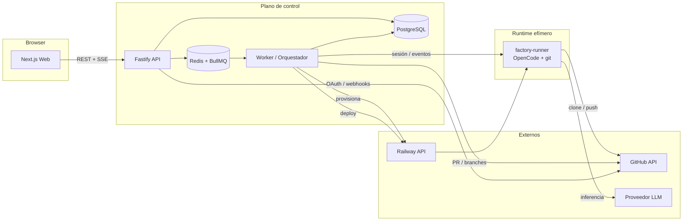
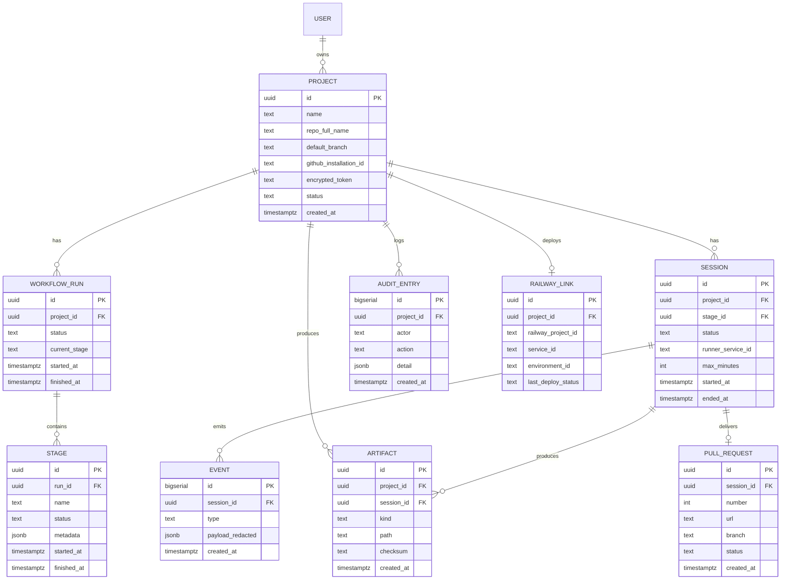
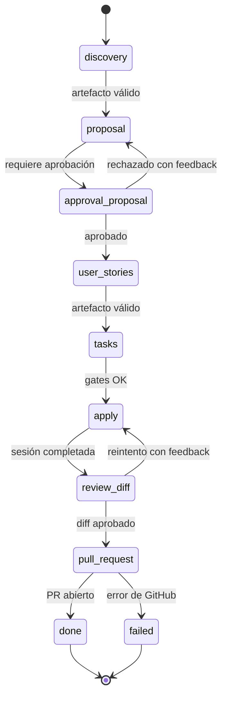
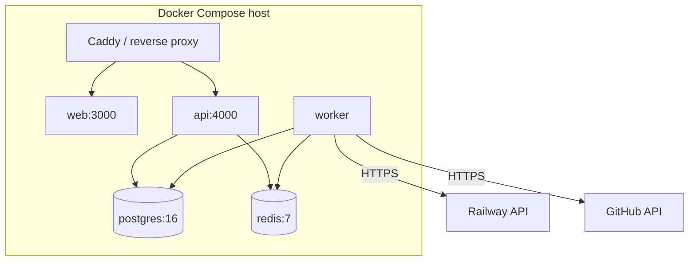

# Design Técnico: Quinoto Software Factory MVP

**Proposal ID:** 2026-11-08-quinoto-software-factory-mvp
**Prefijo:** SWFC-f4c2
**Fecha:** 2026-11-08
**Estado:** proposed

---

## 1. Contexto

Este documento complementa `proposal.md` con las decisiones arquitectónicas del MVP. Define
componentes, modelo de datos, estados, seguridad, topología de despliegue y trade-offs. No repite
los requerimientos: esos viven en `delta-specs/`.

## 2. Principios de diseño

1. **El core no conoce proveedores.** GitHub y Railway son adaptadores detrás de interfaces.
2. **La app no ejecuta código del usuario.** Todo agente corre en un contenedor efímero aislado.
3. **El repositorio es la fuente de verdad del código.** La DB guarda metadatos y vínculos.
4. **Todo cambio es reversible.** Branch + PR + auditoría; nunca escritura directa a `main`.
5. **Fallar de forma segura.** Ante duda de permisos, secretos o estado, se detiene y se reporta.
6. **Self-host primero.** Sin dependencias propietarias; Compose como camino feliz.

## 3. Arquitectura de componentes

### Responsabilidades

| Componente | Responsabilidad | No hace |
|---|---|---|
| `apps/web` | UI, navegación, estados, SSE client | No accede a DB ni a tokens en claro |
| `apps/api` | Auth, validación, REST, SSE, encolado | No ejecuta agentes ni llamadas largas |
| `apps/worker` | Máquina de estados, adaptadores, provisioning | No sirve HTTP al usuario |
| `packages/core` | Entidades, estados, gates, errores, contratos | No conoce HTTP ni SDKs externos |
| `factory-runner` | Clonar repo, ejecutar OpenCode, producir cambios | No recibe tokens de larga duración |
| PostgreSQL | Proyectos, sesiones, artefactos, auditoría | No almacena código fuente completo |
| Redis/BullMQ | Colas, locks, eventos efímeros | No es fuente de verdad |

## 4. Modelo de datos

**Notas**

- `encrypted_token` guarda el ciphertext AES-256-GCM; la clave vive en `FACTORY_MASTER_KEY`.
- `EVENT.payload_redacted` se escribe después de la redacción; nunca se persiste el payload crudo.
- `AUDIT_ENTRY` es append-only: sin updates ni deletes desde la aplicación.
- Migraciones con Drizzle, versionadas y reversibles (`up`/`down`).

## 5. Máquina de estados del workflow

**Reglas**

- Cada transición valida: etapa previa `done`, artefactos requeridos presentes y gates aprobados.
- Un fallo no borra artefactos: la etapa queda `failed` y permite reintento desde checkpoint.
- Una sola sesión activa por proyecto (lock en Redis con TTL renovable).

## 6. Decisiones arquitectónicas (ADR)

### ADR-001 — Monorepo TypeScript con pnpm + Turborepo

- **Contexto:** UI, API, worker y paquetes comparten contratos.
- **Decisión:** monorepo con workspaces, TypeScript estricto y builds incrementales.
- **Consecuencias:** tipado end-to-end y refactors seguros; requiere disciplina de límites entre paquetes.

### ADR-002 — Next.js para UI + Fastify para API

- **Contexto:** la UI necesita streaming y la API necesita control fino de SSE y colas.
- **Decisión:** separar UI (Next.js) y API (Fastify) en procesos distintos.
- **Consecuencias:** despliegue de dos servicios, pero aislamiento y escalado independiente.

### ADR-003 — PostgreSQL + Drizzle

- **Contexto:** metadatos relacionales, auditoría y migraciones confiables.
- **Decisión:** PostgreSQL 16 con Drizzle ORM y migraciones versionadas.
- **Consecuencias:** SQL explícito y testeable; se descarta un ORM pesado.

### ADR-004 — BullMQ + Redis para el orquestador

- **Contexto:** trabajos largos, reintentos y locks.
- **Decisión:** cola BullMQ con worker separado y locks por proyecto.
- **Consecuencias:** operar Redis en self-host; a cambio, reintentos y observabilidad de jobs.

### ADR-005 — GitHub App con manifest flow (no OAuth App)

- **Contexto:** self-hosted, permisos mínimos y tokens de instalación de corta duración.
- **Decisión:** GitHub App creada por manifest flow en la instancia del operador; PAT solo como
  fallback de desarrollo documentado.
- **Consecuencias:** mejor seguridad y permisos acotados; el setup requiere URL pública para webhooks.

### ADR-006 — Runner efímero en Railway

- **Contexto:** PA-003 exige contenedores en Railway; se necesita aislamiento y costo controlado.
- **Decisión:** imagen `factory-runner` con OpenCode + git; un servicio por sesión, destruido al
  terminar; TTL y reconciliación de huérfanos.
- **Consecuencias:** costo variable y dependencia de la API de Railway; se mitiga con caps y
  adaptador aislado.

### ADR-007 — Cifrado AES-256-GCM con clave maestra del operador

- **Contexto:** PA-005 prohíbe tokens en claro.
- **Decisión:** cifrar en la aplicación antes de persistir; clave en variable de entorno; rotación
  documentada.
- **Consecuencias:** si se pierde la clave, se deben reconectar las integraciones; se documenta el
  procedimiento.

### ADR-008 — SSE para logs en vivo

- **Contexto:** streaming unidireccional servidor → navegador.
- **Decisión:** SSE con reconexión y `Last-Event-ID`; WebSocket solo si aparece necesidad bidireccional.
- **Consecuencias:** más simple que WebSocket y compatible con proxies estándar.

## 7. Seguridad

- **Secretos:** cifrado en reposo; nunca se devuelven al cliente; se redactan en logs y eventos.
- **Aislamiento:** un contenedor por sesión; sin montajes del host; usuario no root; red acotada.
- **Tokens de sesión:** credenciales de corta duración inyectadas al runner y revocadas al terminar.
- **GitHub:** permisos mínimos (contents, pull_requests, metadata); webhook firmado.
- **Auditoría:** cada acción sensible genera `AUDIT_ENTRY` con actor, acción y detalle redactado.
- **Telemetría:** deshabilitada por defecto; opt-in explícito del operador.

## 8. Topología de despliegue self-hosted

- `docker compose up -d` levanta web, api, worker, postgres y redis.
- Migraciones al iniciar `api` (idempotentes) y healthcheck en `/healthz` y `/readyz`.
- Volúmenes persistentes para Postgres; backups documentados con `pg_dump`.
- Upgrade: pull de imágenes + migraciones; rollback por tag de imagen anterior.

## 9. Trade-offs

| Decisión | Beneficio | Costo |
|---|---|---|
| Monorepo + múltiples apps | Contratos compartidos y DX | Más piezas para operar |
| Worker separado | Aislamiento de trabajos largos | Un proceso más en Compose |
| Runner en Railway | Cumple PA-003 y aísla ejecución | Dependencia y costo variable |
| GitHub App | Permisos mínimos y tokens cortos | Setup más complejo que OAuth App |
| SSE | Simplicidad | No bidireccional |
| Postgres + Redis | Robustez y colas | Dos servicios que el operador debe respaldar |

## 10. Estrategia de testing

- **Unit (Vitest):** `packages/core` (estados, gates, cifrado, redacción).
- **Integration (Vitest + Testcontainers):** API contra Postgres/Redis reales; migraciones.
- **Contract (MSW/fixtures):** adaptadores GitHub y Railway con respuestas grabadas.
- **E2E (Playwright):** onboarding → workflow → diff → PR con runner mockeado.
- **Seguridad:** test que escanea DB y logs buscando patrones de tokens.
- **CI:** lint + typecheck + unit + integration en cada PR; e2e en main.

## 11. Decisiones abiertas resueltas por esta propuesta

| Pregunta del PRD | Resolución |
|---|---|
| ¿GitHub App u OAuth App? | GitHub App con manifest flow; PAT solo fallback de desarrollo |
| ¿Artefactos en git, DB o ambos? | Fuente de verdad en git; DB guarda metadatos, checksum y vínculos |
| ¿Deploy por proyecto o preview por PR? | Deploy por proyecto en v1; preview por PR en roadmap |
| ¿Runner local? | Fuera de v1; la interfaz de runtime queda preparada |
| ¿Licencias? | Auditoría de licencias bloqueante antes del release |
