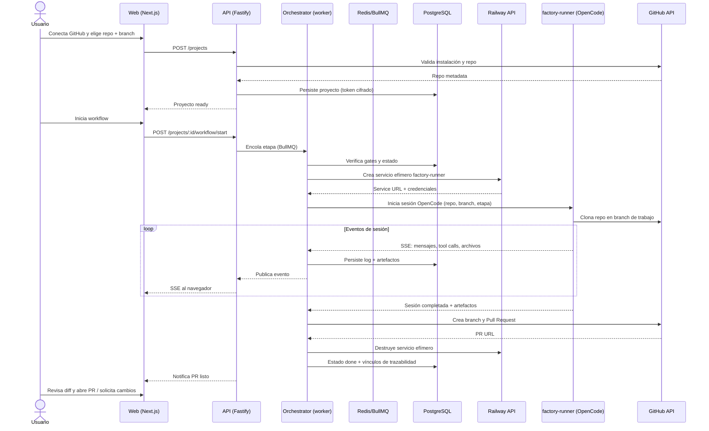

# Propuesta Técnica: Quinoto Software Factory MVP

**Contract Version:** 1
**ID:** 2026-11-08-quinoto-software-factory-mvp
**Prefijo:** SWFC-f4c2
**Fecha de Creación:** 2026-11-08
**Estado:** 🟡 Propuesta
**Aprobación:** 🟢 Aprobada — registro `SWFC-PROPOSAL-APPROVED` (2026-11-08)
**Prioridad:** P1
**Complejidad:** Alta
**Servicios Afectados:** web-ui, orchestrator, agent-runtime, github-adapter, railway-adapter, security, platform
**Autor:** Equipo Quinoto (agente)
**Party Mode:** — No ejecutado

**⚠️ Conflictos Detectados:** Ninguno. No existen propuestas activas previas en `.quinoto-spec/proposals/` y los dominios definidos aquí son nuevos.

---

## Resumen Ejecutivo

**Quinoto Software Factory** es una aplicación web self-hosted y open source que convierte a
OpenCode y QuinotoSpec en una fábrica de software operable desde una UI. Esta propuesta define el
MVP técnico de la v1: conectar un repositorio de GitHub, orquestar el workflow
discovery → propuesta → user stories → tareas → apply, ejecutar agentes de OpenCode en contenedores
efímeros sobre Railway, transmitir logs en vivo y entregar cada cambio como un Pull Request
revisable, con deploy opcional en Railway y un dashboard multi-proyecto.

La arquitectura elegida es un **monorepo TypeScript** con Next.js para la UI, una API Fastify con
SSE para el plano de control, un worker con BullMQ/Redis para el workflow, PostgreSQL como
almacén de metadatos y dos adaptadores aislados (GitHub y Railway) detrás de interfaces
contratadas. Los agentes corren en un contenedor `factory-runner` que expone el servidor de
OpenCode; la app nunca ejecuta código del usuario en su propio proceso.

El resultado esperado es pasar de "repo conectado" a "primer PR" en menos de 15 minutos, con
trazabilidad completa entre artefacto, sesión, commit y PR, y sin que el operador tenga que ceder
sus credenciales a un tercero.

---

## Problema Actual

- **Ceremonia manual:** hoy cada ciclo exige terminal, clonado, prompts, ramas, PR y deploy hechos
  a mano; el flujo se pierde entre herramientas.
- **Estado invisible:** el avance del workflow QuinotoSpec vive en archivos `.quinoto-spec/` que
  nadie mira en tiempo real; no hay una vista de "en qué etapa está cada proyecto".
- **Sin trazabilidad:** no existe un vínculo verificable entre la sesión del agente, el artefacto
  que produjo y el commit/PR que terminó en el repositorio.
- **Adopción frágil:** cada dev ejecuta el proceso a su manera; los pasos se saltean y el valor de
  QuinotoSpec se pierde.
- **Riesgo operativo:** tokens repartidos en terminales, cambios directos a `main`, costos de
  infraestructura sin medición y contenedores huérfanos.
- **Barrera para no técnicos:** product owners y stakeholders no pueden leer logs de CLI ni saber
  si un proyecto está trabado.

---

## Alternativas Consideradas

| Alternativa | Pros | Contras | Descartada porque |
|-------------|------|---------|-------------------|
| **A. SaaS multi-tenant con runners propios** | Menor fricción de onboarding; costos centralizados; upgrades automáticos | Contradice PA-001; obliga a custodiar tokens de terceros; compliance y billing desde el día uno | El acuerdo de producto fija self-hosted y open source para la v1 |
| **B. App de escritorio (Electron/Tauri) que envuelve la CLI** | Reutiliza el entorno local; sin infraestructura de servidor | No es multi-usuario ni multi-proyecto; no hay dashboard compartido; difícil de operar en equipo | No cumple el objetivo de plano de control central y observable |
| **C. Extensión de GitHub + Actions como orquestador** | Cero infraestructura propia; integración natural con PRs | Acopla el producto a GitHub; límites de tiempo y costos de Actions; sin UI rica ni sesiones interactivas | PA-002 pide Railway como runtime y la UI es parte central del producto |
| **D. Monorepo TypeScript + API/worker + Postgres/Redis + runner en Railway (elegida)** | Tipado end-to-end, self-host simple con Compose, adaptadores aislados, SSE nativo, buena DX | Más servicios que una app monolítica; requiere operar Postgres y Redis | Es la única que cumple self-host, multi-proyecto, trazabilidad y runtime en Railway sin ceder control |

---

## Solución Propuesta

### Enfoque

1. **Plano de control (web + API):** Next.js App Router para la UI y Fastify para la API REST/SSE.
   La API valida permisos, encola trabajos y transmite eventos; no ejecuta agentes.
2. **Orquestador (worker):** máquina de estados explícita para las etapas de QuinotoSpec, con
   gates de aprobación, checkpoints y persistencia de artefactos. Corre como proceso separado
   consumiendo una cola BullMQ sobre Redis.
3. **Runtime de agentes:** por cada sesión, el worker crea un servicio efímero en Railway a partir
   de una imagen `factory-runner` (OpenCode + git + toolchain base), le inyecta variables de
   entorno de corta duración y se conecta al servidor de OpenCode por HTTP/SSE.
4. **Adaptadores:** `github-adapter` y `railway-adapter` implementan interfaces del dominio. Toda
   llamada externa pasa por ellos, con reintentos, rate-limit handling y errores tipados.
5. **Seguridad:** tokens cifrados con AES-256-GCM usando `FACTORY_MASTER_KEY`; redacción de
   secretos en logs y eventos; auditoría append-only; un contenedor por sesión.
6. **Entrega:** todo cambio se publica en un branch y se abre un PR. La app nunca empuja a `main`.

### Por qué esta opción

- Cumple los cinco acuerdos de producto vigentes (PA-001 a PA-005).
- Mantiene el core independiente de GitHub y Railway: agregar GitLab o Vercel en v2 es implementar
  una interfaz, no reescribir el orquestador.
- Es self-hostable con un `docker compose up` y no requiere servicios propietarios de Quinoto.
- Permite TDD real: la máquina de estados y los adaptadores se testean sin tocar servicios externos.

---

## Beneficios

- **Tiempo:** reduce el ciclo manual de 30–90 minutos a menos de 15 minutos hasta el primer PR.
- **Calidad:** cada PR llega con artefactos, criterios y diff revisable; los gates impiden saltear
  pasos.
- **DX:** el dev deja de operar terminal, ramas y contenedores; la UI muestra el estado y permite
  cancelar o reintentar.
- **Gobernanza:** timeline auditable de quién ejecutó qué agente, con qué prompt y qué produjo.
- **Costo:** el operador ve y limita el consumo de Railway por proyecto.
- **Negocio:** habilita la adopción de QuinotoSpec por equipos y stakeholders no técnicos.

---

## Alineación con Producto y Acuerdos

### Visión de Producto

La propuesta implementa exactamente la visión de
`.quinoto-spec/discovery/08-product-and-agreements.md`: una fábrica operable desde la UI que
integra OpenCode y QuinotoSpec sin reemplazarlos, con trazabilidad, reversibilidad y progreso
visible.

### KPIs Impactados

| KPI (PRD-0001) | Impacto esperado |
|---|---|
| Tiempo a primer PR ≤ 15 min | Flujo guiado + runtime efímero eliminan el setup manual |
| ≥70% sesiones terminan en PR | Entrega obligatoria por PR y reintentos con checkpoint |
| 100% trazabilidad | Vínculo persistido sesión ↔ artefacto ↔ commit ↔ PR |
| Instalación self-host ≤ 30 min | Docker Compose con migraciones y healthchecks |
| Costo por sesión visible y con cap | Medición por duración + límite configurable |

### Cumplimiento de DoR

- [x] Vinculado a PRD-0001 y a los acuerdos PA-001…PA-005.
- [x] Alcance y out of scope delimitados (§ Alcance).
- [x] Dominios afectados y archivos principales identificados (§ Impacto en el Sistema).
- [x] Criterios de aceptación verificables (§ Criterios de Aceptación y delta specs).
- [x] Dependencias externas y credenciales identificadas por variable (§ Arquitectura).
- [x] Riesgos con mitigación y preguntas abiertas resueltas (§ Riesgos).
- [x] Plan de verificación manual y automatizado (§ Plan de Verificación).
- [x] Estados de UI vacío/loading/error/éxito definidos en `delta-specs/web-ui`.
- [x] Modelo de datos y migraciones reversibles definidos en `design.md`.
- [x] Prefijo `SWFC-f4c2` registrado e ID canónico asignado.
- [x] Aprobación humana de la propuesta registrada en `.quinoto-spec/approvals/SWFC-PROPOSAL-APPROVED.json`.

---

## Arquitectura y Diseño Técnico

### Diagrama de secuencia — flujo principal



### Estructura del monorepo

```text
quinoto-software-factory/
├── apps/
│   ├── web/                 # Next.js 15 (App Router), UI y BFF
│   ├── api/                 # Fastify: REST, SSE, auth, validación
│   └── worker/              # Orquestador + BullMQ + adaptadores
├── packages/
│   ├── core/                # Dominio: workflow, artefactos, errores, contratos
│   ├── adapters-github/     # Implementación GitHub App
│   ├── adapters-railway/    # Implementación Railway API
│   ├── db/                  # Drizzle schema + migraciones
│   └── ui/                  # Componentes compartidos (shadcn/ui)
├── infra/
│   ├── docker-compose.yml   # web, api, worker, postgres, redis
│   └── runner/              # Dockerfile factory-runner (OpenCode + git)
├── .quinoto-spec/
└── package.json             # pnpm workspaces + turbo
```

### Variables de entorno principales

| Variable | Uso | Secreto |
|----------|-----|---------|
| `DATABASE_URL` | Conexión PostgreSQL | Sí |
| `REDIS_URL` | Cola BullMQ | Sí |
| `FACTORY_MASTER_KEY` | Clave maestra AES-256-GCM para cifrar tokens | Sí |
| `GITHUB_APP_ID` / `GITHUB_PRIVATE_KEY` | GitHub App (manifest flow) | Sí |
| `GITHUB_WEBHOOK_SECRET` | Validación de webhooks | Sí |
| `RAILWAY_API_TOKEN` | Crear/destruir runners y deploys | Sí |
| `OPENCODE_MODEL_API_KEY` | Credencial del proveedor LLM | Sí |
| `FACTORY_BASE_URL` | URL pública para OAuth/webhooks | No |
| `MAX_SESSION_MINUTES` / `MAX_SESSIONS_PER_PROJECT` | Guardrails de costo | No |
| `TELEMETRY_ENABLED` | Telemetría opt-in (default `false`) | No |

### Flujo de ejecución paso a paso

1. El operador levanta la instancia con `docker compose up`; las migraciones corren al iniciar.
2. El usuario se autentica localmente y conecta GitHub mediante el manifest flow de la GitHub App.
3. Selecciona repo y branch base; la API cifra el token de instalación y crea el proyecto.
4. Al iniciar el workflow, el orquestador valida gates (DoR, aprobaciones, dependencias de etapa).
5. El worker crea un servicio efímero `factory-runner` en Railway y espera su healthcheck.
6. Se abre una sesión de OpenCode contra el runner con el prompt de la etapa y el contexto del repo.
7. Los eventos se persisten y se reenvían por SSE a la UI con redacción de secretos.
8. Al completar, el orquestador registra artefactos y vínculos de trazabilidad.
9. Si hay cambios, el adaptador de GitHub crea branch + commit + PR con resumen y links.
10. El runner se destruye; el dashboard refleja el nuevo estado y, si aplica, se dispara el deploy.

---

## Especificación Técnica Detallada

Los requerimientos completos viven en `delta-specs/`. Resumen por dominio:

### web-ui
- **AGREGA**: dashboard multi-proyecto, flujo de conexión GitHub, vista de etapas del workflow, visor de sesión con logs en vivo, revisión de diff y confirmación de PR, bandeja de aprobaciones. → ver `delta-specs/web-ui/spec.md#added-requirements`
- **MODIFICA**: Ninguno (no existe spec previo).
- **ELIMINA**: Ninguno.

### orchestrator
- **AGREGA**: máquina de estados del workflow QuinotoSpec, enforcement de gates, tracking de artefactos, reintento desde checkpoint y serialización de sesiones por proyecto. → ver `delta-specs/orchestrator/spec.md#added-requirements`
- **MODIFICA**: Ninguno.
- **ELIMINA**: Ninguno.

### agent-runtime
- **AGREGA**: contenedor efímero por sesión, stream de eventos, ciclo de vida (cancelar/timeout/TTL), persistencia y redacción de logs, límites de recursos. → ver `delta-specs/agent-runtime/spec.md#added-requirements`
- **MODIFICA**: Ninguno.
- **ELIMINA**: Ninguno.

### github-adapter
- **AGREGA**: autenticación GitHub App, descubrimiento de repos, manejo de branches y commits, creación de PRs, manejo de rate limits y webhooks. → ver `delta-specs/github-adapter/spec.md#added-requirements`
- **MODIFICA**: Ninguno.
- **ELIMINA**: Ninguno.

### railway-adapter
- **AGREGA**: validación de token y vinculación de proyecto, provisioning de runners efímeros, disparo y estado de deploys, lectura de logs y guardrails de costo. → ver `delta-specs/railway-adapter/spec.md#added-requirements`
- **MODIFICA**: Ninguno.
- **ELIMINA**: Ninguno.

### security
- **AGREGA**: cifrado de secretos en reposo, redacción en logs, aislamiento de sesiones, auditoría append-only, permisos mínimos y telemetría opt-in. → ver `delta-specs/security/spec.md#added-requirements`
- **MODIFICA**: Ninguno.
- **ELIMINA**: Ninguno.

### platform
- **AGREGA**: despliegue self-hosted con Compose, migraciones automáticas, healthchecks, configuración por entorno, upgrades seguros y observabilidad. → ver `delta-specs/platform/spec.md#added-requirements`
- **MODIFICA**: Ninguno.
- **ELIMINA**: Ninguno.

---

## Riesgos y Mitigaciones

| Riesgo | Probabilidad | Impacto | Mitigación |
|--------|--------------|---------|------------|
| La API de Railway cambia o limita la creación de servicios efímeros | Media | Alto | Adaptador aislado + contrato de integración + fallback documentado a runner local (v2) |
| Costo de contenedores se descontrola | Media | Alto | TTL obligatorio, `MAX_SESSION_MINUTES`, cap por proyecto, reconciliación de huérfanos |
| Fuga de tokens en logs o base de datos | Baja | Crítico | Cifrado AES-256-GCM, redacción centralizada, tests de no-filtración, revisión de seguridad |
| Comportamiento no determinista del agente produce PRs pobres | Alta | Medio | Prompts por etapa, gates, diff obligatorio, reintento con feedback y revisión humana |
| Acoplamiento a APIs internas de OpenCode | Media | Medio | Usar server/SDK documentado, versión pinneada, tests de contrato |
| Sesiones largas bloquean la cola | Media | Medio | Timeout, cancelación, concurrencia configurable y cola por proyecto |
| Rate limits de GitHub | Media | Medio | Backoff exponencial, caché de metadata, operaciones idempotentes |
| Self-host con requisitos poco claros | Media | Medio | Compose documentado, healthcheck, diagnóstico en UI y guía de troubleshooting |
| Licencias incompatibles con open source | Baja | Alto | Auditoría de licencias en CI antes del primer release |

---

## Plan de Implementación

| Fase | Alcance | Estimación |
|------|---------|------------|
| **F0. Fundaciones** | Monorepo, CI, lint/typecheck/test, Compose, Postgres/Redis, esqueleto de API y UI | 1 semana |
| **F1. GitHub + proyectos** | GitHub App (manifest), conexión, repos, creación de proyecto, cifrado de tokens | 1.5 semanas |
| **F2. Orquestador** | Máquina de estados, gates, artefactos, checkpoints, tests de dominio | 2 semanas |
| **F3. Agent runtime** | Imagen `factory-runner`, provisioning Railway, sesión OpenCode, SSE y logs | 2 semanas |
| **F4. Diff + PR** | Captura de cambios, visor de diff, creación de branch/PR, idempotencia | 1.5 semanas |
| **F5. Railway deploy + dashboard** | Vinculación, deploy, estado, dashboard multi-proyecto | 1.5 semanas |
| **F6. Hardening** | Seguridad, auditoría, costo, documentación, e2e, release self-host | 1 semana |

**Total estimado:** ~10.5–11 semanas (1 dev senior + asistencia de agentes).

---

## Criterios de Aceptación (DoD)

- [ ] Un usuario conecta GitHub, elige repo/branch y crea un proyecto sin tocar la terminal.
- [ ] El workflow recorre discovery → propuesta → stories → tareas → apply mostrando estado real.
- [ ] Los gates impiden avanzar sin aprobación cuando corresponde.
- [ ] Una sesión de agente corre en un contenedor efímero de Railway y se destruye al terminar.
- [ ] Los logs llegan a la UI con latencia ≤ 3 s y sin secretos.
- [ ] Cancelar una sesión detiene el contenedor y registra el estado.
- [ ] El resultado se entrega como branch + PR con resumen y artefactos vinculados.
- [ ] La app nunca escribe directo en `main`.
- [ ] El dashboard muestra etapa, sesiones, PRs y deploy por proyecto.
- [ ] `docker compose up` deja la instancia healthy en ≤ 30 min en máquina limpia.
- [ ] Tokens cifrados en reposo y ausentes de logs (test automatizado).
- [ ] Suite de tests verde, lint y typecheck sin errores.
- [ ] Documentación de instalación, operación y troubleshooting publicada.
- [ ] Auditoría de licencias aprobada antes del release.

---

## Plan de Verificación

### Tests manuales

1. **Onboarding:** levantar Compose en máquina limpia, conectar GitHub, crear proyecto y verificar
   estado `ready`. Resultado esperado: proyecto visible en dashboard sin errores de consola.
2. **Workflow:** iniciar el workflow y verificar que cada etapa avanza solo si la anterior terminó
   y los gates están satisfechos. Resultado esperado: etapas bloqueadas/completadas correctas.
3. **Sesión:** lanzar `apply`, ver logs en vivo, cancelar a mitad y confirmar que el contenedor se
   destruye. Resultado esperado: estado `cancelled` y sin servicios huérfanos en Railway.
4. **PR:** completar una sesión, revisar el diff y abrir el PR. Resultado esperado: diff idéntico y
   PR con resumen + artefactos.
5. **Deploy:** vincular Railway, mergear el PR y disparar deploy. Resultado esperado: estado y URL
   visibles en la app.
6. **Seguridad:** inspeccionar DB y logs buscando tokens. Resultado esperado: solo texto cifrado y
   valores redactados.

### Tests automatizados sugeridos

| Tipo | Qué cubrir | Comando |
|------|------------|---------|
| Unit | Máquina de estados, gates, cifrado, redacción, mapeo de errores | `pnpm test` |
| Integration | API + Postgres/Redis con Testcontainers; adaptadores con MSW | `pnpm test:integration` |
| Contract | GitHub y Railway contra fixtures/OpenAPI grabado | `pnpm test:contract` |
| E2E | Onboarding → workflow → PR (con runners mockeados) | `pnpm test:e2e` |
| Static | Lint, typecheck, auditoría de licencias | `pnpm lint && pnpm typecheck && pnpm licenses` |

### Criterio de éxito medible

- Tiempo mediano de "proyecto creado" a "PR abierto" **≤ 15 minutos** en el escenario E2E.
- **0** secretos detectados en DB/logs en la suite de seguridad.
- **100%** de PRs de prueba con artefacto y sesión vinculados.

---

## Impacto en el Sistema

### Archivos nuevos

- `apps/web/**`, `apps/api/**`, `apps/worker/**`
- `packages/core/**`, `packages/adapters-github/**`, `packages/adapters-railway/**`, `packages/db/**`, `packages/ui/**`
- `infra/docker-compose.yml`, `infra/runner/Dockerfile`
- `pnpm-workspace.yaml`, `turbo.json`, `.env.example`
- `.quinoto-spec/specs/**` (al archivar los delta specs)

### Archivos modificados

- `AGENTS.md` (stack y convenciones reales al scaffolear)
- `.quinoto-spec/config.yaml` (stack/lenguaje/testing)
- `README.md` (instalación y operación)

### Dependencias y tooling

- Node.js 22 LTS, pnpm, Turborepo, TypeScript estricto.
- Next.js 15, React 19, Tailwind CSS, shadcn/ui.
- Fastify, Zod, Drizzle ORM, PostgreSQL 16, Redis 7, BullMQ.
- `@opencode-ai/sdk` (o cliente HTTP equivalente), GitHub App SDK (`@octokit/*`).
- Cliente GraphQL de Railway.
- Vitest, Playwright, Testcontainers, MSW, ESLint, Prettier.

---

## Roadmap Futuro (Opcional)

- **v2:** GitLab y Bitbucket; Vercel como destino de deploy; RBAC por equipo; runner local.
- **v2.1:** notificaciones (email/webhook/Slack), plantillas de proyecto, medidor de costo avanzado.
- **v3:** federación multi-repo (Bifrost), marketplace de agentes/plantillas y aprobaciones
  multi-firma.

---

## Conclusión

La propuesta define un MVP coherente con PRD-0001 y con los acuerdos PA-001…PA-005: self-hosted,
open source, GitHub + Railway, agentes en contenedores efímeros y entrega obligatoria por PR. La
arquitectura por capas y adaptadores mantiene el core independiente de proveedores y permite
extender integraciones sin reescribir el orquestador. El siguiente paso es aprobar esta propuesta,
generar las user stories y las tareas atómicas, y arrancar por F0 con TDD.

**Aprobación Requerida:** Sí — stakeholder + revisión de seguridad antes de F3 (runtime de agentes).
**Estimación Total:** ~11 semanas (1 dev senior + agentes).
**Prioridad:** P1.
**Fecha Límite Sugerida:** 2027-01-31.
